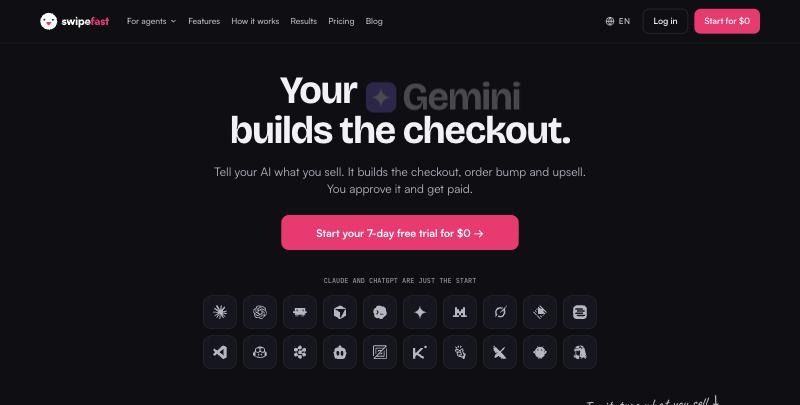

# Swipefast CLI and agent skill

[](https://swipefast.io/agents)

[Swipefast](https://swipefast.io) is the checkout your AI builds: a branded checkout with order bumps, one-click upsells, payment plans and courses, which Claude, ChatGPT and other AI apps can set up for you. You approve anything buyers would see.

This repo has two things:

- **`swipefast`**, a command-line tool for your checkouts and sales.
- **A skill** that teaches AI agents (Claude Code, and any agent that reads Agent Skills) how to use Swipefast safely.

Both talk to the same [Swipefast MCP server](https://swipefast.io/developers/mcp) the AI apps use. This repo is only the client; Swipefast itself is hosted at swipefast.io.

**Try it with a 7-day free trial: [swipefast.io/agents](https://swipefast.io/agents)**

## Install

Node 18 or newer:

```bash
npm install -g swipefast
```

Or run it without installing: `npx swipefast --help`.

The agent skill is one folder you copy: see [The agent skill](#the-agent-skill) below.

## Sign in

```bash
swipefast login
```

Paste your API key when asked. It's in Swipefast under **Settings, Your connection key**. The key is saved in `~/.config/swipefast/config.json`, readable only by you. Prefer an environment variable? Set `SWIPEFAST_API_KEY` instead.

## Commands

```bash
swipefast whoami                  # your account in one look
swipefast products                # every checkout, live and draft
swipefast product the-offer-maker # one checkout, with its bump, upsell and links
swipefast orders --limit 20       # recent orders
swipefast revenue --days 30       # revenue, orders and refunds
swipefast stats the-offer-maker   # visits, conversion, bump and upsell take rates
swipefast findings                # what your performance rules flagged
swipefast publish the-offer-maker # ask to publish; you confirm it in Swipefast
swipefast tools                   # every tool, and whether it reads or writes
swipefast call create_coupon --code LAUNCH20 --kind percent --value 20
```

Add `--json` to any command for compact output, for scripts and agents.

`swipefast call <tool>` runs any tool on the MCP server, so new tools work here the day they ship. Pass arguments as `--name value` pairs, or all at once with `--args '{"days": 30}'`.

## What it can and can't do

- New checkouts are **drafts** until you publish them.
- A change to a **live** checkout doesn't happen straight away. It becomes a request on your Approvals page in Swipefast, and you get an email. Anything you approve can be rolled back.
- `publish` only **asks**. You confirm with one tap in Swipefast.
- Nothing here can refund a buyer.
- The two tools that move money, paying your affiliates (`create_payout_run`) and moving a subscriber to a pricier plan (`change_subscription_plan`), always wait for your approval in Swipefast, and only work with an API key. Claude, ChatGPT and other apps that connect by signing in don't get them.

## The agent skill

`skills/swipefast/SKILL.md` tells an agent when to reach for Swipefast and the rules to follow: never invent prices or links, live changes go to approvals, publishing is your decision.

**Claude Code:** copy the folder into your skills.

```bash
mkdir -p ~/.claude/skills && cp -r skills/swipefast ~/.claude/skills/
```

**Other agents** that read Agent Skills: point them at `skills/swipefast`. Agents without skills can read the same file as instructions.

The skill works with either the MCP server (best: [connect your AI app](https://swipefast.io/agents)) or this CLI.

## Connect an AI app instead

Step-by-step setup for [20 AI apps](https://swipefast.io/agents), including [Claude](https://swipefast.io/claude), [ChatGPT](https://swipefast.io/chatgpt), [Claude Code](https://swipefast.io/claude-code), [Cursor](https://swipefast.io/cursor), [Codex](https://swipefast.io/codex), [Gemini](https://swipefast.io/gemini), [VS Code](https://swipefast.io/vscode), [Grok](https://swipefast.io/grok), [Manus](https://swipefast.io/manus) and [OpenClaw](https://swipefast.io/openclaw). Automations: [Zapier](https://swipefast.io/zapier), [Make](https://swipefast.io/make), [n8n](https://swipefast.io/n8n).

## Links

- [Swipefast](https://swipefast.io): the checkout your AI builds, from $29 a month with a 7-day free trial, 0% of your sales
- [MCP server docs](https://swipefast.io/developers/mcp)
- [REST API](https://swipefast.io/developers/api)
- [Status](https://swipefast.io/status)

MIT licensed. Issues and ideas welcome.
